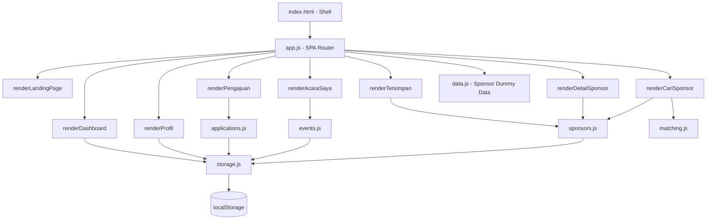
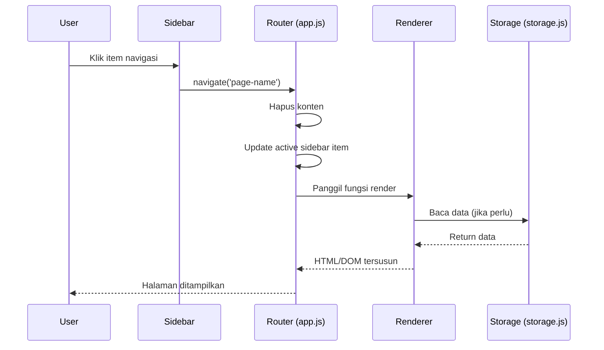

# Design Document

## Overview

TemuSponsor adalah platform web frontend berbasis HTML5, CSS3, dan Vanilla JavaScript yang menghubungkan panitia acara dengan calon sponsor yang sesuai. Platform ini beroperasi sepenuhnya di sisi klien (browser) tanpa backend server — seluruh data disimpan di `localStorage` dan tidak ada panggilan API eksternal.

Arsitektur utama menggunakan pola **Single Page Application (SPA)** dengan JavaScript router berbasis DOM, di mana setiap "halaman" adalah fungsi JavaScript yang me-render HTML ke dalam satu elemen kontainer (`#main-content`). Tidak ada framework UI yang digunakan; semua komponen dibangun dengan Vanilla JS dan DOM API.

**Tujuan desain:**
- Navigasi antar 8 halaman tanpa reload browser
- Smart Matching Engine yang menghitung skor kesesuaian sponsor–acara (0–100 poin)
- CRUD lengkap untuk Acara dan Pengajuan via localStorage
- UI konsisten menggunakan design system berbasis CSS custom properties
- Responsif dari lebar layar 320px hingga 1920px

---

## Architecture

### Pola Arsitektur: SPA dengan Modul ES6

Platform menggunakan arsitektur **modular SPA** di mana `index.html` berfungsi sebagai shell tunggal. Navigasi ditangani oleh `app.js` yang memetakan nama halaman ke fungsi renderer. Setiap modul JS mengekspor fungsi-fungsi yang dipanggil oleh router atau modul lain.



### Alur Navigasi

Navigasi dilakukan melalui fungsi `navigate(pageName, params)` yang:
1. Menerima nama halaman dan parameter opsional
2. Menghapus konten `#main-content`
3. Memanggil fungsi renderer yang sesuai
4. Memperbarui highlight item aktif di Sidebar
5. Menyimpan state halaman saat ini



### Layer Arsitektur

| Layer | File | Tanggung Jawab |
|---|---|---|
| Shell | `index.html` | Struktur HTML dasar, load semua modul, layout sidebar + topbar + main |
| Router | `app.js` | Navigasi SPA, inisialisasi aplikasi, manajemen state aktif |
| Data | `data.js` | 15+ data dummy sponsor sebagai array statis |
| Feature Logic | `sponsors.js`, `matching.js`, `events.js`, `applications.js` | Logika bisnis per fitur |
| Persistence | `storage.js` | Abstraksi seluruh operasi localStorage |
| Styling | `css/style.css` | Design system, layout, responsivitas |

---

## Components and Interfaces

### 1. SPA Router (`app.js`)

Router merupakan inti platform. Bertanggung jawab atas rendering halaman, state navigasi, dan inisialisasi komponen global.

```js
// Route registry
const routes = {
  'landing':        renderLandingPage,    // dari app.js
  'dashboard':      renderDashboard,      // dari app.js
  'cari-sponsor':   renderCariSponsor,    // dari sponsors.js
  'detail-sponsor': renderDetailSponsor, // dari sponsors.js
  'acara-saya':     renderAcaraSaya,      // dari events.js
  'pengajuan':      renderPengajuan,      // dari applications.js
  'tersimpan':      renderTersimpan,      // dari sponsors.js
  'profil':         renderProfil          // dari app.js
};

// Fungsi utama navigasi
function navigate(page, params = {}) {
  currentPage = page;
  currentParams = params;
  // Update sidebar highlight
  // Clear #main-content
  // Call renderer
}

// Inisialisasi
function initApp() {
  renderShell();      // Render sidebar + topbar
  navigate('landing'); // Default halaman awal
}
```

**State global yang dikelola `app.js`:**
- `currentPage` — string nama halaman aktif
- `currentParams` — object parameter halaman (mis. `{ sponsorId: 'sp-01' }`)
- `searchState` — object state filter pencarian (persisten saat navigasi balik)

### 2. Storage Manager (`storage.js`)

Semua baca/tulis localStorage hanya boleh melalui `StorageManager`. Tidak ada akses `localStorage` langsung di luar modul ini.

```js
const StorageManager = {
  // Generic
  get(key),                        // JSON.parse(localStorage.getItem(key))
  set(key, value),                 // localStorage.setItem(key, JSON.stringify(value))
  remove(key),                     // localStorage.removeItem(key)

  // Bookmarks
  getBookmarks(),                  // → Sponsor[]
  addBookmark(sponsor),            // Tambah ke ts_bookmarks, set savedAt
  removeBookmark(sponsorId),       // Filter dari ts_bookmarks

  // Events
  getEvents(),                     // → Event[]
  saveEvent(event),                // Push ke ts_events, generate ID jika kosong
  updateEvent(event),              // Replace by event.id
  deleteEvent(eventId),            // Filter dari ts_events

  // Applications
  getApplications(),               // → Application[]
  saveApplication(app),            // Push ke ts_applications

  // Profile
  getProfile(),                    // → Profile | null
  saveProfile(profile),            // Set ts_profile
};
```

**localStorage Keys:**
| Key | Tipe | Konten |
|---|---|---|
| `ts_bookmarks` | `Sponsor[]` | Sponsor yang di-bookmark |
| `ts_events` | `Event[]` | Acara yang dibuat panitia |
| `ts_applications` | `Application[]` | Pengajuan yang dikirim |
| `ts_profile` | `Profile` | Data profil pengguna |

### 3. Matching Engine (`matching.js`)

Komponen murni (pure function) tanpa side effects. Menerima profil acara dan array sponsor, mengembalikan array sponsor berurutan berdasarkan skor.

```js
// Bobot scoring
const WEIGHTS = {
  category:      30,  // sponsor.category === event.category
  location:      20,  // sponsor.location === event.location ATAU "Seluruh Indonesia"
  supportType:   25,  // 5 poin per jenis dukungan cocok (maks 25)
  targetAudience: 15, // event.targetAudience overlap dengan sponsor.targetAudience
  eventType:     10   // event.eventType ada dalam sponsor.suitableEvents
};

// Klasifikasi label
const LABELS = {
  'Sangat Direkomendasikan': { min: 85, max: 100 },
  'Direkomendasikan':        { min: 70, max: 84  },
  'Cukup Relevan':           { min: 50, max: 69  },
  'Alternatif':              { min: 0,  max: 49  }
};

// Antarmuka publik
function calculateScore(sponsor, eventProfile) → number  // 0–100
function classifyScore(score) → string                   // Label klasifikasi
function runMatching(eventProfile, sponsors) → ScoredSponsor[]
  // Mengembalikan array { ...sponsor, score, label } diurutkan score DESC
```

### 4. Sponsor Module (`sponsors.js`)

Mengelola halaman Cari Sponsor, Detail Sponsor, dan Sponsor Tersimpan.

```js
// Cari Sponsor
function renderCariSponsor(params)
function applyFilters(sponsors, filters) → Sponsor[]   // Filter kumulatif
function sortSponsors(sponsors, sortOrder) → Sponsor[] // Sort A-Z, Z-A, default
function renderSponsorGrid(sponsors)                   // Update DOM grid

// Detail Sponsor
function renderDetailSponsor(params)                   // params.sponsorId

// Sponsor Tersimpan
function renderTersimpan()

// Bookmark
function toggleBookmark(sponsorId)                     // Add/remove + Toast
function isBookmarked(sponsorId) → boolean
```

**Filter State Object:**
```js
{
  keyword:    string,   // search bar
  category:   string,   // dropdown filter
  location:   string,   // dropdown filter
  support:    string,   // dropdown filter
  scale:      string,   // dropdown filter
  eventType:  string,   // dropdown filter
  sortOrder:  string    // 'name-asc' | 'name-desc' | 'default'
}
```

### 5. Events Module (`events.js`)

Mengelola CRUD acara dengan validasi dan persistensi.

```js
function renderAcaraSaya()
function saveEvent(formData) → Event    // Validasi + generate ID + StorageManager.saveEvent
function updateEvent(formData) → Event  // Validasi + StorageManager.updateEvent
function deleteEvent(eventId)           // Konfirmasi Modal + StorageManager.deleteEvent
function renderEventCards(events)       // Update DOM grid cards
```

**Event ID Format:** `EVT-YYYYMMDD-XXXX` (XXXX = 4 digit random hex)

### 6. Applications Module (`applications.js`)

Mengelola form pengajuan dan riwayat pengajuan.

```js
function renderPengajuan(params)        // params.sponsorId (opsional, pre-fill)
function validateForm(formData) → ValidationResult
function showPreviewModal(formData)     // Tampilkan Modal ringkasan
function submitApplication(formData)   // Validasi + save + Toast + reset form
function renderApplicationHistory()    // Tabel riwayat pengajuan
```

**Application ID Format:** `APP-YYYYMMDD-XXXX`

### 7. Toast System (global, didefinisikan di `app.js`)

```js
function showToast(message, type = 'success')
// type: 'success' | 'warning' | 'danger'
// Warna: success=#16A36A, warning=#E6A23C, danger=#DC5353
// Auto-dismiss: 3000ms
// Posisi: fixed bottom-right
// Animasi: slide-in dari kanan, fade-out saat dismiss
```

### 8. Modal System (global, didefinisikan di `app.js`)

```js
function showModal({ title, content, onConfirm, onCancel })
function closeModal()
// Overlay semi-transparent
// Tombol Konfirmasi dan Batal
// Menutup saat klik overlay
```

### 9. UI Component Helpers

Fungsi utilitas untuk menghasilkan HTML string komponen yang digunakan berulang:

```js
// Semua mengembalikan HTML string
function renderSponsorCard(sponsor, options)   // options: { showScore, showBookmark }
function renderBadge(text, color)
function renderEmptyState(message, ctaText, ctaAction)
function renderLoadingSpinner()
function formatDate(dateString) → string       // "DD MMMM YYYY" dalam Bahasa Indonesia
function generateId(prefix) → string           // "EVT-20240115-A3F2"
```

---

## Data Models

### Sponsor Object

```js
{
  id: string,                    // "sp-01" hingga "sp-15"
  name: string,                  // Nama perusahaan fiktif
  logo: string,                  // URL placeholder atau initial letters
  category: string,              // Satu dari: "Food & Beverage" | "Technology" | "Education" |
                                 //   "Fashion" | "Media" | "Healthcare" | "Transportation" |
                                 //   "Retail" | "Beauty" | "Printing"
  location: string,              // "Malang" | "Surabaya" | "Bandung" | "Jakarta" | "Yogyakarta" |
                                 //   "Seluruh Indonesia"
  businessScale: string,         // "UMKM" | "Startup" | "Perusahaan Menengah" | "Perusahaan Besar"
  description: string,           // Deskripsi singkat (1–2 kalimat)
  fullDescription: string,       // Deskripsi lengkap untuk halaman detail
  supportTypes: string[],        // ["Dana" | "Produk" | "Voucher" | "Merchandise" |
                                 //   "Media Partner" | "Fasilitas" | "Workshop" | "Diskon Cetak"]
  suitableEvents: string[],      // ["Seminar" | "Workshop" | "Festival" | "Pameran" |
                                 //   "Pentas Seni" | "Kompetisi" | "Kegiatan Sosial" |
                                 //   "Olahraga" | "Semua Jenis Acara"]
  targetAudience: string[],      // ["Pelajar" | "Mahasiswa" | "Profesional" | "Umum" | "UMKM"]
  requirements: string,          // Persyaratan pengajuan sponsor
  website: string,               // URL website
  email: string,                 // Email kontak
  phone: string,                 // Nomor telepon
  sponsoredEvents: string[],     // Riwayat acara yang pernah disponsori
  status: "active" | "inactive"
}
```

**15 Data Dummy Sponsor:**

| # | Nama | Kategori | Lokasi | Skala | Dukungan | Kesesuaian Acara |
|---|---|---|---|---|---|---|
| 1 | Malang Creative Print | Printing | Malang | UMKM | Merchandise, Diskon Cetak, Produk | Seminar, Pameran, Workshop |
| 2 | Kopi Ruang Lokal | Food & Beverage | Malang | UMKM | Produk, Voucher, Dana | Festival, Pentas Seni, Kegiatan Sosial |
| 3 | TechNova Solutions | Technology | Surabaya | Startup | Dana, Produk, Workshop | Seminar, Workshop, Kompetisi |
| 4 | EduGrow Academy | Education | Malang | Startup | Voucher, Produk, Dana | Seminar, Workshop, Kompetisi |
| 5 | UrbanWear Studio | Fashion | Bandung | UMKM | Merchandise, Produk | Festival, Pentas Seni, Pameran |
| 6 | Nusantara Digital Media | Media | Jakarta | Perusahaan Menengah | Media Partner, Dana | Seminar, Festival, Kompetisi, Pameran |
| 7 | Apotek Sehat Bersama | Healthcare | Malang | UMKM | Produk, Voucher | Kegiatan Sosial, Seminar, Olahraga |
| 8 | GreenLine Transport | Transportation | Surabaya | Startup | Fasilitas, Voucher | Festival, Olahraga, Kegiatan Sosial |
| 9 | Batik Nusantara Craft | Fashion | Yogyakarta | UMKM | Merchandise, Produk | Pameran, Festival, Pentas Seni |
| 10 | Surya Retail Group | Retail | Surabaya | Perusahaan Besar | Dana, Voucher, Merchandise | Semua Jenis Acara |
| 11 | Brilian Stationery | Retail | Malang | UMKM | Produk, Diskon, Merchandise | Workshop, Seminar, Pameran |
| 12 | Jago Beauty Studio | Beauty | Bandung | Startup | Produk, Voucher, Merchandise | Festival, Pentas Seni, Pameran |
| 13 | CloudHost Indonesia | Technology | Jakarta | Perusahaan Menengah | Dana, Produk | Seminar, Workshop, Kompetisi |
| 14 | Warung Sehat Organik | Food & Beverage | Yogyakarta | UMKM | Produk, Voucher | Kegiatan Sosial, Festival, Olahraga |
| 15 | Prima Offset Printing | Printing | Bandung | Perusahaan Menengah | Produk, Merchandise, Diskon Cetak | Semua Jenis Acara |

### Event Object

```js
{
  id: string,                    // "EVT-YYYYMMDD-XXXX"
  name: string,                  // Nama acara
  organizer: string,             // Nama organisasi penyelenggara
  category: string,              // Kategori acara
  date: string,                  // ISO date string "YYYY-MM-DD"
  location: string,              // Kota atau lokasi spesifik
  targetParticipants: number,    // Perkiraan jumlah peserta
  description: string,           // Deskripsi acara
  targetAudience: string[],      // Array target audiens
  estimatedBudget: number,       // Estimasi kebutuhan dana (opsional)
  neededSupport: string[],       // Jenis dukungan yang dibutuhkan
  createdAt: string              // ISO datetime string
}
```

### Application Object

```js
{
  id: string,                    // "APP-YYYYMMDD-XXXX"
  sponsorId: string,             // ID sponsor yang dituju
  sponsorName: string,           // Nama sponsor (denormalized untuk display)
  organizationName: string,      // Nama organisasi pengaju
  picName: string,               // Nama penanggung jawab
  email: string,                 // Email (harus valid: mengandung @ dan domain)
  phone: string,                 // Nomor telepon
  eventName: string,             // Nama acara
  eventCategory: string,         // Kategori acara
  eventDate: string,             // Tanggal acara "YYYY-MM-DD"
  eventLocation: string,         // Lokasi acara
  estimatedParticipants: number, // Perkiraan jumlah peserta
  eventDescription: string,      // Deskripsi acara
  cooperationForm: string,       // Bentuk kerja sama yang diinginkan
  sponsorBenefit: string,        // Benefit yang ditawarkan kepada sponsor
  expectedSupport: number,       // Nominal dukungan yang diharapkan (dalam rupiah)
  proposalFileName: string,      // Nama file proposal PDF yang diunggah
  status: "Menunggu" | "Diproses" | "Diterima" | "Ditolak",
  submittedAt: string            // ISO datetime string
}
```

### Profile Object

```js
{
  fullName: string,              // Nama lengkap pengguna
  organizationName: string,      // Nama organisasi
  email: string,                 // Email (harus valid)
  phone: string,                 // Nomor telepon
  logoDataUrl: string,           // Data URL gambar logo (base64)
  description: string,           // Deskripsi organisasi
  location: string               // Lokasi organisasi
}
```

### Filter State Object

```js
{
  keyword:   string,   // Kata kunci pencarian (nama atau kategori)
  category:  string,   // Filter kategori bisnis
  location:  string,   // Filter lokasi
  support:   string,   // Filter bentuk dukungan
  scale:     string,   // Filter skala perusahaan
  eventType: string,   // Filter kesesuaian acara
  sortOrder: string    // 'default' | 'name-asc' | 'name-desc'
}
```

---

## Correctness Properties

*A property is a characteristic or behavior that should hold true across all valid executions of a system — essentially, a formal statement about what the system should do. Properties serve as the bridge between human-readable specifications and machine-verifiable correctness guarantees.*

### Property 1: Filter kumulatif menghasilkan subset

*For any* daftar sponsor dan kombinasi filter aktif, setiap sponsor yang ditampilkan setelah filter diterapkan harus memenuhi semua kondisi filter secara bersamaan — tidak ada sponsor yang lolos tanpa memenuhi seluruh filter yang aktif, dan tidak ada sponsor yang cocok yang dihilangkan.

**Validates: Requirements 4.2, 4.3, 4.4, 4.5, 4.6, 4.7, 4.8**

### Property 2: Urutan sort konsisten

*For any* daftar sponsor, menerapkan urutan "Nama A-Z" menghasilkan daftar di mana setiap sponsor pada posisi i memiliki nama yang secara alfabetis ≤ sponsor pada posisi i+1; menerapkan "Nama Z-A" menghasilkan kebalikannya.

**Validates: Requirements 4.9, 4.10**

### Property 3: Skor Matching_Engine berada dalam rentang valid

*For any* kombinasi profil acara dan data sponsor, skor yang dihasilkan oleh `calculateScore` selalu bernilai antara 0 dan 100 (inklusif), dan jumlah skor dari semua komponen tidak melebihi 100.

**Validates: Requirements 6.2, 6.6**

### Property 4: Klasifikasi skor konsisten dengan batas label

*For any* skor numerik antara 0 dan 100, `classifyScore` mengembalikan tepat satu label: skor 85–100 menghasilkan "Sangat Direkomendasikan", skor 70–84 menghasilkan "Direkomendasikan", skor 50–69 menghasilkan "Cukup Relevan", dan skor 0–49 menghasilkan "Alternatif". Tidak ada skor yang menghasilkan label kosong atau undefined.

**Validates: Requirements 6.3**

### Property 5: Hasil matching diurutkan dari skor tertinggi

*For any* profil acara dan daftar sponsor, array yang dikembalikan oleh `runMatching` diurutkan secara menurun berdasarkan skor — setiap elemen pada posisi i memiliki skor ≥ elemen pada posisi i+1.

**Validates: Requirements 6.4**

### Property 6: Bookmark round-trip konsisten

*For any* sponsor, menambahkan sponsor ke bookmark lalu memeriksanya dengan `isBookmarked(sponsorId)` selalu mengembalikan `true`; menghapusnya lalu memeriksa kembali selalu mengembalikan `false`.

**Validates: Requirements 5.5, 5.6, 5.7**

### Property 7: Validasi email menolak format tidak valid

*For any* string yang tidak mengandung karakter "@" atau tidak mengandung domain (karakter setelah "@"), validasi email di form Pengajuan dan Profil harus mengembalikan `false` dan mencegah penyimpanan.

**Validates: Requirements 8.7, 10.4**

### Property 8: Penyimpanan dan pembacaan Event idempoten

*For any* objek Event dengan data valid, menyimpannya via `StorageManager.saveEvent` kemudian membacanya kembali via `StorageManager.getEvents` menghasilkan objek dengan properti yang identik dengan yang disimpan (round-trip persisten).

**Validates: Requirements 9.2, 9.3**

### Property 9: Penyimpanan dan pembacaan Application idempoten

*For any* objek Application dengan data valid, menyimpannya via `StorageManager.saveApplication` kemudian membacanya kembali via `StorageManager.getApplications` menghasilkan objek dengan properti yang identik, termasuk ID unik yang digenerate (round-trip persisten).

**Validates: Requirements 8.5**

### Property 10: Filter pencarian real-time — subset dari data penuh

*For any* kata kunci pencarian dan daftar sponsor lengkap, hasil filter hanya berisi sponsor yang nama atau kategorinya mengandung kata kunci tersebut (case-insensitive), dan selalu merupakan subset dari daftar asli.

**Validates: Requirements 4.2**

---

## Error Handling

### Strategi Penanganan Error

Karena platform beroperasi sepenuhnya di klien tanpa backend, sumber error utama adalah:
1. Data localStorage yang rusak atau tidak valid
2. Input pengguna yang tidak valid
3. Operasi DOM pada elemen yang tidak ada
4. File upload dengan format/ukuran tidak sesuai

### 1. localStorage — Defensive Read

Semua operasi `StorageManager.get()` dibungkus dengan `try/catch`. Jika data tidak dapat di-parse (mis. data korup), nilai default dikembalikan:

```js
get(key) {
  try {
    const raw = localStorage.getItem(key);
    return raw ? JSON.parse(raw) : null;
  } catch (e) {
    console.warn(`[StorageManager] Gagal membaca key "${key}":`, e);
    return null;
  }
}
```

**Nilai default per key:**
- `ts_bookmarks` → `[]`
- `ts_events` → `[]`
- `ts_applications` → `[]`
- `ts_profile` → `{}`

### 2. Validasi Form

Validasi dilakukan sebelum setiap operasi simpan. Error ditampilkan inline di bawah field yang tidak valid menggunakan elemen `.field-error`.

| Kondisi | Pesan Error |
|---|---|
| Field wajib kosong | "Field ini wajib diisi" |
| Email tidak valid | "Masukkan format email yang valid" |
| File bukan PDF | "Hanya file PDF yang diperbolehkan" |
| Form matching tidak lengkap | "Harap isi semua field sebelum mencari sponsor" |

Prinsip: validasi gagal tidak menghapus data yang sudah diisi pengguna.

### 3. Empty States

Setiap halaman yang menampilkan data dari localStorage harus menangani kondisi data kosong:

| Halaman | Kondisi | Tampilan |
|---|---|---|
| Sponsor Tersimpan | `ts_bookmarks` kosong | Pesan + tombol CTA ke Cari Sponsor |
| Acara Saya | `ts_events` kosong | Pesan + petunjuk membuat acara pertama |
| Riwayat Pengajuan | `ts_applications` kosong | Pesan "Belum ada pengajuan" |

### 4. Route Not Found

Jika `navigate()` dipanggil dengan nama halaman yang tidak ada dalam route registry, router menampilkan pesan "Halaman tidak ditemukan" di `#main-content`.

### 5. File Upload Validation

```js
function validateProposalFile(file) {
  if (!file) return { valid: false, message: "File proposal wajib diunggah" };
  if (!file.name.endsWith('.pdf')) return { valid: false, message: "Hanya file PDF yang diperbolehkan" };
  if (file.size > 10 * 1024 * 1024) return { valid: false, message: "Ukuran file maksimal 10MB" };
  return { valid: true };
}
```

### 6. Console Error Prevention

Semua manipulasi DOM menggunakan optional chaining atau pengecekan null sebelum operasi:

```js
const el = document.querySelector('#target');
if (el) el.innerHTML = content;  // Tidak error jika elemen belum ada
```

---

## Testing Strategy

### Pendekatan Pengujian

Platform ini adalah aplikasi frontend berbasis Vanilla JavaScript dengan logika bisnis murni (pure functions) di `matching.js` dan `storage.js`, sehingga memenuhi syarat untuk **property-based testing** pada komponen logika. Komponen UI (rendering, navigasi) diuji dengan **example-based unit tests** dan **snapshot tests**.

### Library

- **Property-based testing**: [fast-check](https://github.com/dubzzz/fast-check) — library JavaScript/TypeScript untuk PBT
- **Unit testing**: [Vitest](https://vitest.dev/) atau Jest
- **DOM testing**: jsdom (environment untuk unit test DOM manipulation)

Setiap property test dikonfigurasi dengan minimum **100 iterasi**.

### Unit Tests (Example-Based)

Unit test fokus pada skenario konkret dan edge case:

| Skenario | File Target |
|---|---|
| Navigasi ke halaman valid merender konten yang benar | `app.js` |
| Navigasi ke halaman tidak valid menampilkan 404 | `app.js` |
| Toast muncul dengan warna yang sesuai tipe | `app.js` (showToast) |
| Toast menghilang setelah 3 detik | `app.js` (showToast) |
| Email "user@domain.com" dianggap valid | `applications.js`, `profil` |
| Email "userdomain.com" dianggap tidak valid | `applications.js`, `profil` |
| File "proposal.pdf" diterima | `applications.js` |
| File "proposal.docx" ditolak | `applications.js` |
| Filter kosong (semua aktif) mengembalikan semua sponsor | `sponsors.js` |
| Filter dengan 0 hasil menampilkan pesan kosong | `sponsors.js` |

### Property-Based Tests

Setiap property test menggunakan fast-check dengan arbitraries yang sesuai:

#### Property 1: Filter kumulatif menghasilkan subset
```
// Feature: temusponsor-platform, Property 1: Filter kumulatif menghasilkan subset
fc.property(
  fc.array(arbitrarySponsor()),
  arbitraryFilterState(),
  (sponsors, filters) => {
    const result = applyFilters(sponsors, filters);
    // Setiap hasil harus memenuhi semua filter aktif
    return result.every(s => matchesAllFilters(s, filters));
    // Dan merupakan subset dari input
    && result.every(s => sponsors.includes(s));
  }
)
```

#### Property 2: Urutan sort konsisten
```
// Feature: temusponsor-platform, Property 2: Urutan sort konsisten
fc.property(
  fc.array(arbitrarySponsor(), { minLength: 2 }),
  (sponsors) => {
    const asc = sortSponsors(sponsors, 'name-asc');
    const desc = sortSponsors(sponsors, 'name-desc');
    return isSortedAscending(asc, s => s.name)
      && isSortedDescending(desc, s => s.name);
  }
)
```

#### Property 3: Skor Matching_Engine dalam rentang 0–100
```
// Feature: temusponsor-platform, Property 3: Skor Matching_Engine berada dalam rentang valid
fc.property(
  arbitrarySponsor(),
  arbitraryEventProfile(),
  (sponsor, eventProfile) => {
    const score = calculateScore(sponsor, eventProfile);
    return score >= 0 && score <= 100;
  }
)
```

#### Property 4: Klasifikasi skor konsisten
```
// Feature: temusponsor-platform, Property 4: Klasifikasi skor konsisten dengan batas label
fc.property(
  fc.integer({ min: 0, max: 100 }),
  (score) => {
    const label = classifyScore(score);
    if (score >= 85) return label === 'Sangat Direkomendasikan';
    if (score >= 70) return label === 'Direkomendasikan';
    if (score >= 50) return label === 'Cukup Relevan';
    return label === 'Alternatif';
  }
)
```

#### Property 5: Hasil matching diurutkan dari skor tertinggi
```
// Feature: temusponsor-platform, Property 5: Hasil matching diurutkan dari skor tertinggi
fc.property(
  arbitraryEventProfile(),
  fc.array(arbitrarySponsor(), { minLength: 1 }),
  (eventProfile, sponsors) => {
    const result = runMatching(eventProfile, sponsors);
    return isSortedDescending(result, r => r.score);
  }
)
```

#### Property 6: Bookmark round-trip konsisten
```
// Feature: temusponsor-platform, Property 6: Bookmark round-trip konsisten
fc.property(
  arbitrarySponsor(),
  (sponsor) => {
    StorageManager.addBookmark(sponsor);
    const afterAdd = StorageManager.isBookmarked(sponsor.id);
    StorageManager.removeBookmark(sponsor.id);
    const afterRemove = StorageManager.isBookmarked(sponsor.id);
    return afterAdd === true && afterRemove === false;
  }
)
```

#### Property 7: Validasi email
```
// Feature: temusponsor-platform, Property 7: Validasi email menolak format tidak valid
fc.property(
  fc.string().filter(s => !s.includes('@') || !s.match(/@.+\..+/)),
  (invalidEmail) => {
    return validateEmail(invalidEmail) === false;
  }
)
```

#### Property 8: Penyimpanan Event idempoten
```
// Feature: temusponsor-platform, Property 8: Penyimpanan dan pembacaan Event idempoten
fc.property(
  arbitraryEvent(),
  (event) => {
    StorageManager.saveEvent(event);
    const retrieved = StorageManager.getEvents().find(e => e.id === event.id);
    return deepEqual(retrieved, event);
  }
)
```

#### Property 9: Penyimpanan Application idempoten
```
// Feature: temusponsor-platform, Property 9: Penyimpanan dan pembacaan Application idempoten
fc.property(
  arbitraryApplication(),
  (app) => {
    StorageManager.saveApplication(app);
    const retrieved = StorageManager.getApplications().find(a => a.id === app.id);
    return deepEqual(retrieved, app);
  }
)
```

#### Property 10: Filter pencarian — subset dari data penuh
```
// Feature: temusponsor-platform, Property 10: Filter pencarian real-time — subset dari data penuh
fc.property(
  fc.array(arbitrarySponsor()),
  fc.string(),
  (sponsors, keyword) => {
    const result = applyFilters(sponsors, { keyword });
    const lc = keyword.toLowerCase();
    return result.every(s =>
      s.name.toLowerCase().includes(lc) ||
      s.category.toLowerCase().includes(lc)
    ) && result.every(s => sponsors.includes(s));
  }
)
```

### Integration Tests

| Skenario | Deskripsi |
|---|---|
| Full bookmark flow | Tambah bookmark → cek di halaman Tersimpan → hapus → konfirmasi hilang |
| Full application flow | Isi form → pratinjau Modal → kirim → cek di riwayat pengajuan |
| Full event flow | Buat acara → edit → hapus dengan konfirmasi Modal |
| Profil tersimpan di Topbar | Simpan profil → nama dan logo terupdate di Topbar tanpa reload |
| Navigasi lintas halaman | Klik CTA Detail → masuk detail sponsor → klik Buat Pengajuan → nama sponsor terisi otomatis |
